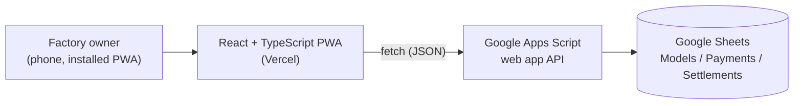

<div align="center">

# Factory Accounts

**An installable Arabic (RTL) web app that replaces a small clothing factory's messy manual bookkeeping with an automatic running balance between the factory and its trader.**


</div>

<!--
TODO before publishing: add the live demo link here, e.g.
**Live demo:** https://your-app.vercel.app
-->

## Overview

A small clothing factory used to track its account with a trader by hand: models delivered, price per piece, fabric used, and the trader's weekly payments. Totals were recalculated manually and often went wrong.

Factory Accounts records every delivered **model** and every **payment**, and computes the current balance automatically. It is in use by the factory today.

I designed and built it end to end on my own as a freelance project: requirements and feedback with the factory owner, UI/UX, the React frontend, the Google Apps Script backend, and deployment.

The interface is entirely in Arabic (right-to-left) and mobile-first, because the owner uses it from a phone.

<!--TODO: add screenshots -->

## Features

**Accounting**

- Record **models**: name, date, quantity, price per piece and fabric per piece. Totals (price and fabric) are calculated for you.
- Record **payments** on account, on any date, with optional notes. Payments are not tied to a specific model.
- Live **balance** = total work value − total payments. The balance card changes color with the state: red when the trader is owed money, blue when the factory is owed money, green when the account is settled.
- **Settlement**: close the account up to a chosen day. From the next day the balance starts fresh, while older records stay visible (dimmed and marked as settled) and a settlement can be cancelled from the settlement history.
- **Custom period**: calculate the balance from a chosen model to a chosen model (the end defaults to the latest), and optionally stop counting payments at a chosen payment.
- **Weekly chart** of work value versus payments for the last 7 weeks (weeks start on Saturday).

**Usability**

- Searchable model and payment pickers with a month-and-year filter, built for people who remember a model by its name and date, not an ID.
- Tables sorted newest first, with text search and a month filter. Only the first 50 rows render, with a "show more" button, so the app stays fast as data grows.
- Add, edit and delete with confirmation, plus validation with inline errors on every form.
- Installable on a phone like a native app, with a garment-themed look (scissors, thread spool and mannequin icons, stitched borders).

## Tech stack

| Area | Technology |
| --- | --- |
| UI | React 19, TypeScript 6, Vite 8, plain CSS (mobile-first, RTL) |
| State | React Context with a local cache (`localStorage`) |
| PWA | `vite-plugin-pwa` (Workbox service worker, web app manifest) |
| Backend | Google Apps Script web app (REST-style JSON API) |
| Database | Google Sheets (`Models`, `Payments`, `Settlements`) |
| Hosting | Vercel |

## Architecture



The business rules live in pure, framework-free functions in [`src/utils/calculations.ts`](src/utils/calculations.ts): period selection, balance, settlement preview and weekly grouping. The UI only displays what they return.

### Balance rules

- **Balance** = total work value − total payments. Positive means the factory is owed money, negative means the trader is owed money, and zero means the account is settled. It is an amount due, not profit or loss, because the factory's own costs are not recorded.
- Payments count from the start model's date onward. If a payment is chosen as the end, every payment up to and including that day is counted.
- A settlement closes the account up to and including its date. Only records after that date are counted, unless "show from the beginning" is turned on.

## Getting started

### Prerequisites

- Node.js 20.19+ (or 22.12+) and npm
- A deployed Google Apps Script backend (see [Backend setup](#backend-setup-google-apps-script))

### Install and run

```bash
git clone https://github.com/Habiba0079/FactoryDashboard.git
cd FactoryDashboard
npm install
```

Create a `.env` file in the project root:

```bash
VITE_API_URL=<your Apps Script web app URL ending in /exec>
VITE_API_TOKEN=<the same value you set as API_TOKEN in the script properties>
```

Then start the dev server:

```bash
npm run dev
```

> Never commit `.env`. Values prefixed with `VITE_` are embedded in the built frontend, so treat the token as a shared key, not a private secret.

### Scripts

| Command | Description |
| --- | --- |
| `npm run dev` | Start the development server |
| `npm run build` | Type-check and create a production build in `dist/` |
| `npm run preview` | Preview the production build locally (the service worker only runs in a build) |
| `npm run lint` | Run ESLint |

## Backend setup (Google Apps Script)

1. Create a Google Sheet with two tabs, **Models** and **Payments**, with these header rows:

   | Models | |
   | --- | --- |
   | Columns | `ID`, `Date`, `Model`, `Quantity`, `PricePerPiece`, `FabricCm`, `TotalPrice`, `TotalFabric` |

   | Payments | |
   | --- | --- |
   | Columns | `ID`, `Date`, `Amount`, `Notes` |

   The first column must always be `ID`. A **Settlements** tab is created automatically the first time it is needed.
2. In the sheet, open **Extensions → Apps Script** and paste the contents of [`apps-script/Code.gs`](apps-script/Code.gs).
3. Under **Project Settings → Script properties**, add `API_TOKEN` with a long random value.
4. Choose **Deploy → New deployment → Web app**, execute as **Me**, and set access to **Anyone**. Copy the `/exec` URL into `VITE_API_URL`.
5. After any later change to the script, create a **new version** of the deployment, otherwise the old code keeps running.

## Deployment

The frontend is a static Vite build and is deployed to Vercel. Add `VITE_API_URL` and `VITE_API_TOKEN` in the Vercel project settings, then deploy. Build-time variables are baked in, so redeploy after changing them.

## Project structure

```
FactoryDashboard/
├── apps-script/
│   └── Code.gs            # Backend: API, validation, settlements
├── public/                # Icons and favicon
├── src/
│   ├── components/        # Forms, modals, searchable picker, weekly chart, icons
│   ├── data/              # DataProvider: shared state and local cache
│   ├── pages/             # Dashboard, Models, Payments
│   ├── services/          # api.ts: all calls to the Apps Script API
│   ├── types/             # Shared TypeScript types
│   ├── utils/             # Balance and period logic, formatting, validation
│   ├── App.tsx            # Layout and tab navigation
│   └── main.tsx
├── index.html
└── vite.config.ts         # Vite and PWA configuration
```

## Engineering notes

- **Why Google Sheets:** the owner already thinks in spreadsheets, can inspect the data at any time, and it costs nothing to host. Apps Script gives it a small, validated API on top.
- **Speed:** the first version was slow because the script re-opened the spreadsheet for every date cell. It now opens it once per request, the app loads everything in a single request, and it shows the last saved data instantly while refreshing in the background.
- **Data safety:** edits and deletes use record IDs (never row numbers), writes are serialized with a script lock, validation runs on both the client and the server, and columns are matched by header name, so reordering sheet columns does not break the app.
- **Reliable responses:** Apps Script redirects POST responses in a way that was unreliable in practice, so write actions are sent as token-guarded GET requests.

## Author

Designed and built by [Habiba](https://github.com/Habiba0079).

